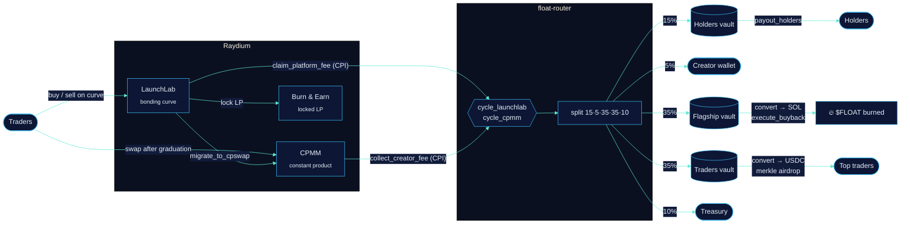

<div align="center">


<br/>

[](https://solana.com)
[](programs/float-router)
[](crates/float-core)
[](packages/sdk)
[](package.json)
[](#-quality)
[](LICENSE)

**[Docs](docs/README.md)** · **[Program spec](docs/programs/float-router.md)** · **[SDK](docs/developers/sdk.md)** · **[CLI](docs/developers/cli.md)** · **[Scripts](docs/developers/scripts.md)** · **[Contracts](docs/contracts.md)**


## ◆ What this is

[Float](https://www.floatlaunch.xyz/) launches coins on Solana on top of **Raydium LaunchLab**. Instead of keeping the platform fee, it splits every coin's fees five ways and pays them out automatically. This repository is a complete, self-verifying toolkit around those mechanics:

<table>
<tr>
<td width="33%" valign="top">

### 📚 Documentation

Every section of Float's docs, expanded: fee split, fee cycling, holder rewards, trader airdrops, $FLOAT buybacks, tickers, pairs, risks and contracts. Plus architecture, a Raydium integration reference, auditing guides, FAQ and glossary.

**→ [`docs/`](docs/README.md)**

</td>
<td width="33%" valign="top">

### ⛓️ On-chain programs

**`float-router`** (Anchor) enforces every rule on chain: coin registry, ticker escrow, Raydium CPIs, the exact split, guarded swaps, burn-in-the-same-instruction buybacks, holder payouts and merkle airdrops.
**`float-core`** (Rust, `no_std`, zero deps) holds the shared math.

**→ [`programs/`](programs/float-router) · [`crates/`](crates/float-core)**

</td>
<td width="33%" valign="top">

### 🧰 SDK · CLI · Bots

A **zero-dependency** TypeScript SDK (IDL-driven Raydium integration), a 14-command **CLI**, and production-shaped **keeper**, **payout bot** and **airdrop pipeline** scripts. They simulate by default.

**→ [`packages/`](packages) · [`scripts/`](scripts)**

</td>
</tr>
</table>

<br/>

## ◆ Contents

- [Fee model](#-fee-model)
- [Architecture](#-architecture)
- [Quick start](#-quick-start)
- [CLI in 20 seconds](#-cli-in-20-seconds)
- [The router program](#-the-router-program)
- [SDK](#-sdk)
- [Operations: bots & scripts](#-operations-bots--scripts)
- [Specifications](#-specifications)
- [Repository layout](#-repository-layout)
- [Quality](#-quality)
- [Security](#-security)
- [Roadmap](#-roadmap)
- [Contributing](#-contributing) · [License](#-license)

<br/>

## ◆ Fee model

<div align="center">

</div>

| Bucket | Share | Paid in | How it reaches people |
| :-- | --: | :-- | :-- |
| **Holders** | 15% | paired token | Payout bot every few minutes, pro rata, wherever you bought. Token account created once you're owed ≥ $2; smaller amounts roll over; sellers forfeit unpaid amounts to remaining holders |
| **Creator** | 5% | paired token | Wallet chosen at launch |
| **Flagship** | 35% | SOL → $FLOAT | Buy at ~5 SOL or every 4 h, ≤ 1% price impact per buy, **burned on chain** |
| **Traders** | 35% | USDC | Airdropped to top wallets by volume. Bots and wash volume excluded; new pairs count after 7 days |
| **Treasury** | 10% | paired token | Platform treasury, plus 1 SOL ticker-reuse fees |

Fees accumulate in Raydium's vaults until someone presses **Cycle fees**. Anyone can, and the payout bot does it automatically. → [Fee split](docs/mechanics/fee-split.md) · [Fee cycling](docs/mechanics/fee-cycling.md)

<br/>

## ◆ Architecture



<details>
<summary><b>Lifecycle of a single cycle</b> (sequence diagram)</summary>


</details>

<br/>

## ◆ Quick start

> **Requirements:** Node.js ≥ 22.18 (runs TypeScript natively). Rust stable for `float-core`. Anchor 0.31.1 + Solana 2.1 to build the program.

```bash
git clone https://github.com/<you>/float-community && cd float-community
npm install                       # dev-only deps: typescript, @types/node

npm test                          # SDK, CLI, router client, keeper e2e
cargo test -p float-core          # Rust core
anchor build                      # float-router (+ IDL)
```

<details>
<summary><b>Read-only tour</b></summary>

```bash
export SOLANA_RPC_URL=https://your-rpc.example
npm run float -- addresses                    # every Float & Raydium address, with Solscan links
npm run float -- split 12.5                   # how 12.5 SOL of fees splits
npm run float -- ticker '$pepe' --taken PEPE  # launch cost & refund rule
npm run float -- pool  <coin-mint>            # curve progress, fee rates
npm run float -- cycle <coin-mint>            # what "Cycle fees" would route right now
npm run float -- payouts --wallet <wallet>    # holder payouts you've received
npm run float -- burns                        # $FLOAT buyback burns
```

</details>

<details>
<summary><b>Deploy your own router (devnet)</b></summary>

```bash
scripts/router/deploy.sh devnet
node scripts/router/init.ts --operator <bot> --treasury <wallet> \
  --flagship-mint <mint> --platform-config <launchlab-platform-config> --pairs <mint,...> --send
# then set platform_fee_wallet and platform_cp_creator = router authority on the LaunchLab platform config
node scripts/keeper/keeper.ts --flagship-pool <FLOAT/SOL CPMM> --send
node scripts/keeper/payout-bot.ts --prices prices.json --send
```

</details>

<br/>

## ◆ CLI in 20 seconds

<div align="center">

</div>

| Read-only | Offline | Transactions |
| :-- | :-- | :-- |
| `addresses` · `split` · `ticker` · `pool` · `quote` · `cycle` · `inspect` · `holders` · `burns` · `payouts` | `airdrop` (rank + allocate from CSV) · `buyback` (≤ 1% impact plan) | `buy` · `sell` on the bonding curve: **simulated unless `--send`** |

→ [CLI reference](docs/developers/cli.md)

<br/>

## ◆ The router program

`programs/float-router` · Anchor 0.31.1 · 18 instructions · 5 account types · 11 events · 34 errors

| Area | Instruction | Caller | Enforced on chain |
| :-- | :-- | :-- | :-- |
| Coins | `register_coin` | pool creator | LaunchLab pool PDA + platform config + creator; ticker counter; **1 SOL escrow** on reuse |
| | `mark_graduated` | anyone | LaunchLab `status == 2` |
| | `settle_ticker_fee` | anyone | Refund if graduated ≤ 48 h, else release to treasury |
| Cycling | `cycle_launchlab` | anyone | CPI `claim_platform_fee`; balance-delta attribution; exact split |
| | `cycle_cpmm` | anyone | CPI `collect_creator_fee`; pool creator = router authority |
| | `swap_base_fees` | operator | Coin-side fees → paired token, price guard |
| Flagship | `convert_vault` | operator | Flagship → **WSOL only**, traders → **USDC only**, price guard |
| | `execute_buyback` | operator | 5 SOL / 4 h trigger · **on-chain simulated impact ≤ 1%** · guard · **burn in the same ix** |
| Holders | `payout_holders` | operator | ≤ 20 recipients · paired-mint accounts only · `Σ ≤ holders_unpaid` |
| Traders | `create_airdrop` / `claim_airdrop` / `close_airdrop` | operator / anyone / operator | sha256 merkle (domain-separated) · one receipt per leaf · `Σ ≤ total` |
| Admin | `initialize` · `update_config` · `set_paused` · `propose_admin` · `accept_admin` | admin | Validated bounds · two-step admin transfer |

**Invariants:** conservation of every cycled amount · per-coin attribution · holder solvency · burn completeness · airdrop integrity · bounded slippage. → [Full specification](docs/programs/float-router.md)

<br/>

## ◆ SDK

```ts
import { Connection, MINTS, PublicKey, launchLab, previewCycle, router } from "@float-community/sdk";

const conn = new Connection(process.env.SOLANA_RPC_URL!);
const coin = new PublicKey("<coin-mint>");

// Raydium LaunchLab, decoded straight from the vendored IDL
const pool = await launchLab.fetchLaunchLabPool(conn, launchLab.launchLabPda.pool(coin, MINTS.WSOL));
const quote = launchLab.quoteBuyExactIn(pool.pool, 1_000_000_000n, launchLab.feeRatesOf(pool));

// What a "Cycle fees" would route right now
const { split } = await previewCycle(conn, coin, MINTS.WSOL);

// float-router instructions, account order generated from the Rust source
const ix = new router.RouterClient().cycleLaunchLab(payer, coinRecord, config, pool.pool.quote_vault);
```

| Layer | Highlights |
| :-- | :-- |
| **Core** | base58 · ed25519 on-curve check · PDAs · borsh · Anchor IDL coder with PDA resolution · JSON-RPC · legacy tx signing via `node:crypto` |
| **Raydium** | LaunchLab (curve quotes, fee split, trade & claim ixs, `TradeEvent` decoding) · CPMM (port of `CurveCalculator`) · Burn & Earn |
| **Float** | split · cycle preview · holder snapshots & payout model · airdrop ranking/allocation/merkle · buyback sizing · price guard · tickers · pairs · burn/payout history |
| **Router** | `RouterClient` (18 builders) · PDAs · account decoders · `fetchAllCoins` |

→ [SDK guide](docs/developers/sdk.md)

<br/>

## ◆ Operations: bots & scripts

| Script | Role |
| :-- | :-- |
| [`scripts/router/deploy.sh`](scripts/router/deploy.sh) | keys sync → build (optionally verifiable) → IDL check → deploy |
| [`scripts/router/init.ts`](scripts/router/init.ts) | Config + vaults for WSOL, USDC, $FLOAT and every paired mint |
| [`scripts/keeper/keeper.ts`](scripts/keeper/keeper.ts) | `mark_graduated` → `settle_ticker_fee` → `cycle_*` → `swap_base_fees` → `convert_vault` → `execute_buyback` |
| [`scripts/keeper/payout-bot.ts`](scripts/keeper/payout-bot.ts) | Snapshot → payout model → batched `payout_holders`, with a persistent rollover ledger |
| [`scripts/airdrop/`](scripts/airdrop) | `build` (rank + allocate + merkle) → `publish` (verify every proof, commit root) → `distribute` (push claims, skip receipts) |

Every script **simulates by default**, logs structured JSON with `LOG_JSON=1`, and is exercised end to end against a mock RPC in CI. → [Scripts](docs/developers/scripts.md)

<br/>

## ◆ Specifications

<details open>
<summary><b>Protocol constants</b></summary>

| Constant | Value | Source |
| :-- | :-- | :-- |
| Split (bps) | holders 1500 · creator 500 · flagship 3500 · traders 3500 · treasury 1000 | `float_core::split::SplitBps::FLOAT` |
| Holder ATA threshold | $2 | `ATA_CREATION_THRESHOLD_USD` |
| Buyback trigger | 5 SOL or 4 h | `buyback::TARGET_LAMPORTS`, `MAX_INTERVAL_SECS` |
| Buyback impact cap | 1% (100 bps) | `buyback::MAX_IMPACT_BPS` |
| Cycle price guard | 2% (200 bps), max 10% | `guard::DEFAULT_GUARD_BPS` |
| Ticker | 1–10 `[A-Za-z0-9]`, case-insensitive | `ticker::Ticker::parse` |
| Ticker reuse fee | 1 SOL, refunded on graduation ≤ 48 h | `ticker::REUSE_FEE_LAMPORTS` |
| Reuse fee effective | `1793851260` = 2026-11-05 04:01 UTC (Nov 4, 10:01 PM CST) | `ticker::REUSE_FEE_EFFECTIVE_TS` |
| Airdrop bot rule | > 300 trades in an hour, or > 100/h in ≥ 5 hours | `BOT_RULES` |
| New-pair maturity | 7 days | `NEW_PAIR_MATURITY_MS` |
| Airdrop #1 / #2 | 2026-11-04 17:00 UTC top 100 · 2026-11-11 17:00 UTC top 250 | `AIRDROP_SCHEDULE` |

</details>

<details>
<summary><b>Addresses (mainnet)</b></summary>

| | Address |
| :-- | :-- |
| Float program | [`3KguFi7YYzLgttG46fRism16CfcuNCkDh6U7td9JTqxX`](https://solscan.io/account/3KguFi7YYzLgttG46fRism16CfcuNCkDh6U7td9JTqxX) |
| Float config | [`AgaKFP4SfEeeM4r4GcSWBwpEAbfHh7wLkJGHqpWrLBQV`](https://solscan.io/account/AgaKFP4SfEeeM4r4GcSWBwpEAbfHh7wLkJGHqpWrLBQV) |
| $FLOAT | [`Bv1a7cEj5aRnJQhMw4kRQqAFesMSd5LwcDnUzq52BMmr`](https://solscan.io/account/Bv1a7cEj5aRnJQhMw4kRQqAFesMSd5LwcDnUzq52BMmr) |
| Buyback & burn vault | [`8CskoMx4FaXjp7gzxNzaWQXGXGVBWYnNWXGcisXuDYAa`](https://solscan.io/account/8CskoMx4FaXjp7gzxNzaWQXGXGVBWYnNWXGcisXuDYAa) |
| Trader airdrop vault | [`JEK3WrPuiePy8vYmzN7Xfk6YoMChbsiqzBs7X43y3snH`](https://solscan.io/account/JEK3WrPuiePy8vYmzN7Xfk6YoMChbsiqzBs7X43y3snH) |
| Holder payout bot | [`6LYfrwR67XS8zJPxD2PTEHKocr3d2MBgkZX8umGTfw6E`](https://solscan.io/account/6LYfrwR67XS8zJPxD2PTEHKocr3d2MBgkZX8umGTfw6E) |
| Treasury | [`2LMWFmbGBfw78ZEas2NFmAYfo4bhyBqYboYh9nk3mDFQ`](https://solscan.io/account/2LMWFmbGBfw78ZEas2NFmAYfo4bhyBqYboYh9nk3mDFQ) |
| Raydium LaunchLab | [`LanMV9sAd7wArD4vJFi2qDdfnVhFxYSUg6eADduJ3uj`](https://solscan.io/account/LanMV9sAd7wArD4vJFi2qDdfnVhFxYSUg6eADduJ3uj) |
| Raydium CPMM | [`CPMMoo8L3F4NbTegBCKVNunggL7H1ZpdTHKxQB5qKP1C`](https://solscan.io/account/CPMMoo8L3F4NbTegBCKVNunggL7H1ZpdTHKxQB5qKP1C) |
| Raydium Burn & Earn | [`LockrWmn6K5twhz3y9w1dQERbmgSaRkfnTeTKbpofwE`](https://solscan.io/account/LockrWmn6K5twhz3y9w1dQERbmgSaRkfnTeTKbpofwE) |
| float-router (reference, default id) | `AYBmMVxnWC2o5JGPZm8xo4nrh7fAmxLfrxC3e2RaKomt` |

</details>

<details>
<summary><b>Router PDAs</b></summary>

| Account | Seeds |
| :-- | :-- |
| `RouterConfig` | `["config"]` |
| authority | `["authority"]` |
| `CoinRecord` | `["coin", mint]` |
| `TickerRecord` | `["ticker", TICKER]` |
| ticker escrow | `["ticker_escrow", mint]` |
| vault | `["vault", kind:u8, mint]` (0 holders · 1 flagship · 2 traders) |
| `AirdropRound` / escrow | `["airdrop", round_le]` / `["airdrop", round_le, "escrow"]` |
| `ClaimReceipt` | `["claim", round_le, index_le]` |

</details>

<br/>

## ◆ Repository layout

```text
float-community/
├── programs/float-router/      Anchor program: coins, cycling, split, buyback, payouts, airdrops
│   └── src/{instructions,raydium,state}/ …
├── crates/float-core/          no_std Rust: split · ticker · cpmm · buyback · guard · merkle · zero-copy views
├── packages/
│   ├── sdk/                    @float-community/sdk: core · raydium · float · router (+ vendored IDLs)
│   └── cli/                    @float-community/cli: the `float` command
├── scripts/
│   ├── router/                 deploy.sh · init.ts
│   ├── keeper/                 keeper.ts · payout-bot.ts
│   ├── airdrop/                build.ts · publish.ts · distribute.ts
│   ├── dev/                    IDL generator & checker · fixtures · README assets
│   └── test/                   keeper end-to-end against a mock RPC
├── vendor/raydium/             Raydium CPMM Rust source (Apache-2.0), pinned commit + checksums
├── docs/                       user, mechanics, rewards, programs and developer documentation
└── examples/                   runnable scripts and sample CSVs
```

<br/>

## ◆ Quality

| What | How it's verified | Count |
| :-- | :-- | --: |
| Rust core | `cargo test`, `clippy -D warnings`, `rustfmt --check` | 27 |
| SDK | `node:test`: primitives, IDL coder, Raydium math & layouts, Float rules, merkle, router client | 91 |
| CLI | End to end against a mock RPC serving IDL-encoded accounts | 8 |
| Scripts | Keeper run against a mock RPC; the simulated wire tx is decoded and checked | 1 |
| Program ↔ client | IDL **generated from the Rust source** and checked in `npm test`; Anchor's IDL diffed in CI | ✓ |
| Rust ↔ TypeScript | Shared vectors: split, CPMM swaps, buyback cap, merkle root/proof fixture, byte offsets vs. IDL encoding | ✓ |
| Raydium | Every vendored discriminator equals `sha256("global:…")`; PDAs reproduce `GpMZbSM2…`, `WLHv2UAZ…`, `3f7GcQFG…` | ✓ |

```bash
npm run check && cargo test -p float-core && anchor build && node scripts/dev/check-anchor-idl.ts target/idl/float_router.json
```

<br/>

## ◆ Security

- `float-router` is **unaudited reference code**. Don't deploy it with real funds before an independent audit.
- Every transaction path in the CLI and scripts **simulates by default**.
- The trust model is documented per instruction: permissionless routes, bounded operator powers, admin within validated limits. → [spec](docs/programs/float-router.md#trust-model)
- Report vulnerabilities privately: see [SECURITY.md](SECURITY.md). Float program issues go to the Float team; Raydium issues go to Raydium's bug bounty.

<br/>

## ◆ Roadmap

- [x] Documentation for every section of the official docs
- [x] Zero-dependency SDK with IDL-driven Raydium integration
- [x] `float` CLI
- [x] `float-core` + `float-router` with Raydium LaunchLab/CPMM CPIs
- [x] Keeper, payout bot, merkle airdrop pipeline
- [ ] LiteSVM integration tests against cloned Raydium bytecode
- [ ] TWAP reference prices from CPMM `ObservationState`
- [ ] Token-2022 transfer-fee aware routing for pre-IPO pairs
- [ ] Versioned transactions + address lookup tables for larger payout batches
- [ ] Independent audit

<br/>

## ◆ Contributing

PRs are welcome. Start with [CONTRIBUTING.md](CONTRIBUTING.md). Ground rules: the official docs win, the Float program is never guessed at, the SDK stays dependency-free, and vendored files stay verbatim.

## ◆ License

[MIT](LICENSE) for everything in this repository except `vendor/raydium/cp-swap-src` (Apache-2.0, see [NOTICE](NOTICE)).
"Float", "$FLOAT" and "Raydium" belong to their respective owners and are used only to describe what this project interoperates with.

<div align="center">
<br/>

<br/>
<sub>Built by the community, for the community. Not affiliated with Float.</sub>
</div>
