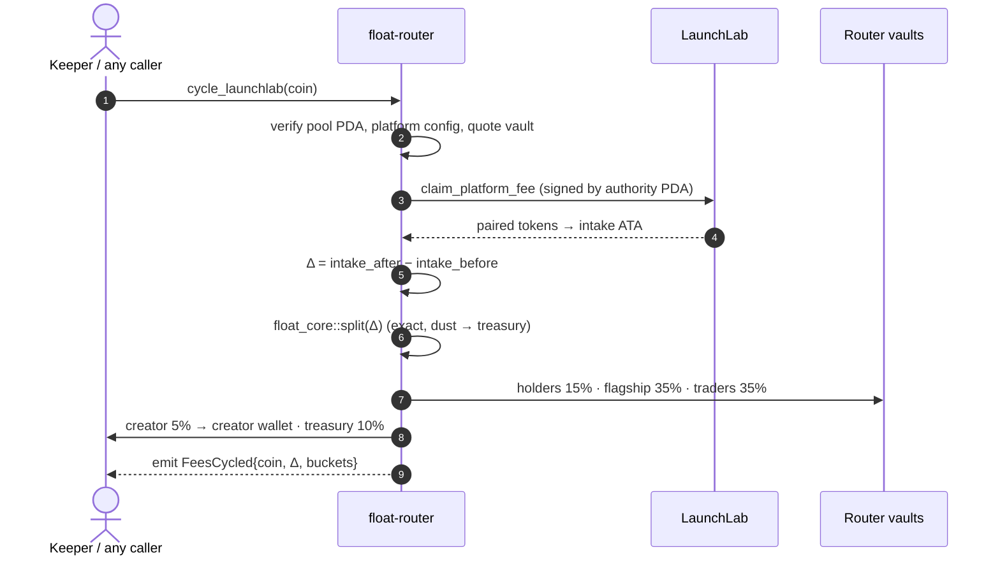

<div align="center">



<br/>

[](https://solana.com)
[](programs/float-router)
[](crates/float-core)
[](packages/sdk)
[](package.json)
[](#quality-assurance)
[](LICENSE)

**[Documentation](docs/README.md)** · **[Program Specification](docs/programs/float-router.md)** · **[SDK Guide](docs/developers/sdk.md)** · **[CLI Reference](docs/developers/cli.md)** · **[Scripts](docs/developers/scripts.md)** · **[Contracts](docs/contracts.md)**

</div>

<br/>

## Overview

[Float](https://www.floatlaunch.xyz/) is a token launch platform on Solana built on **Raydium LaunchLab**. Rather than retaining the platform fee, Float distributes the fees generated by every coin across five recipients and settles them automatically.

This repository provides a complete, independently verifiable toolkit for those mechanics:

<table>
<tr>
<td width="33%" valign="top">

### Documentation

Comprehensive coverage of every section of the official Float documentation: fee split, fee cycling, holder rewards, trader airdrops, $FLOAT buybacks, tickers, pairs, risks and contracts. Supplemented by an architecture overview, a Raydium integration reference, auditing guides, an FAQ and a glossary.

**→ [`docs/`](docs/README.md)**

</td>
<td width="33%" valign="top">

### On-chain programs

**`float-router`** (Anchor) enforces every protocol rule on chain: coin registry, ticker escrow, Raydium CPIs, exact fee split, price-guarded swaps, buybacks burned within the same instruction, holder payouts and merkle airdrops.

**`float-core`** (Rust, `no_std`, no dependencies) contains the shared math.

**→ [`programs/`](programs/float-router) · [`crates/`](crates/float-core)**

</td>
<td width="33%" valign="top">

### SDK, CLI and operations

A **dependency-free** TypeScript SDK with IDL-driven Raydium integration, a 14-command **CLI**, and production-grade **keeper**, **payout bot** and **airdrop pipeline** scripts. All transaction paths run in simulation mode by default.

**→ [`packages/`](packages) · [`scripts/`](scripts)**

</td>
</tr>
</table>

<br/>

## Table of Contents

1. [Overview](#overview)
2. [Fee Model](#fee-model)
3. [Architecture](#architecture)
4. [Getting Started](#getting-started)
   - [Requirements](#requirements)
   - [Installation and Testing](#installation-and-testing)
   - [Read-Only Tour](#read-only-tour)
   - [Deploying a Router on Devnet](#deploying-a-router-on-devnet)
5. [Command-Line Interface](#command-line-interface)
6. [On-Chain Program: `float-router`](#on-chain-program-float-router)
7. [TypeScript SDK](#typescript-sdk)
8. [Operations: Bots and Scripts](#operations-bots-and-scripts)
9. [Protocol Reference](#protocol-reference)
   - [Protocol Constants](#protocol-constants)
   - [Mainnet Addresses](#mainnet-addresses)
   - [Router PDAs](#router-pdas)
10. [Repository Layout](#repository-layout)
11. [Quality Assurance](#quality-assurance)
12. [Security](#security)
13. [Roadmap](#roadmap)
14. [Contributing](#contributing)
15. [License](#license)

<br/>

## Fee Model

<div align="center">

</div>

| Recipient | Share | Settlement asset | Distribution |
| :-- | --: | :-- | :-- |
| **Holders** | 15% | Paired token | Distributed pro rata by the payout bot every few minutes, regardless of where the tokens were acquired. A token account is created once the amount owed reaches $2; smaller balances roll over. Unpaid amounts of wallets that sell are redistributed to remaining holders. |
| **Creator** | 5% | Paired token | Sent to the wallet designated at launch. |
| **Flagship** | 35% | SOL → $FLOAT | Used to buy $FLOAT once ~5 SOL accumulates or every 4 hours, with at most 1% price impact per purchase. Purchased tokens are **burned on chain**. |
| **Traders** | 35% | USDC | Airdropped to the top wallets by trading volume. Bot activity and wash trading are excluded; new pairs become eligible after 7 days. |
| **Treasury** | 10% | Paired token | Platform treasury. Also receives the 1 SOL ticker reuse fees. |

Fees accumulate in Raydium's vaults until a **Cycle fees** transaction is executed. The operation is permissionless and is also triggered automatically by the payout bot.

→ [Fee split](docs/mechanics/fee-split.md) · [Fee cycling](docs/mechanics/fee-cycling.md)

<br/>

## Architecture


<details>
<summary><b>Lifecycle of a fee cycle</b> (sequence diagram)</summary>



</details>

<br/>

## Getting Started

### Requirements

| Component | Version | Purpose |
| :-- | :-- | :-- |
| Node.js | ≥ 22.18 | SDK, CLI and scripts (TypeScript runs natively) |
| Rust | stable | `float-core` |
| Anchor | 0.31.1 | Building `float-router` |
| Solana CLI | 2.1 | Building and deploying `float-router` |

### Installation and Testing

```bash
git clone https://github.com/<you>/float-community && cd float-community
npm install                       # development dependencies only: typescript, @types/node

npm test                          # SDK, CLI, router client and keeper end-to-end tests
cargo test -p float-core          # Rust core
anchor build                      # float-router and its IDL
```

### Read-Only Tour

The following commands query mainnet state without submitting any transaction:

```bash
export SOLANA_RPC_URL=https://your-rpc.example
npm run float -- addresses                    # All Float and Raydium addresses, with Solscan links
npm run float -- split 12.5                   # Distribution of 12.5 SOL in fees
npm run float -- ticker '$pepe' --taken PEPE  # Launch cost and refund conditions
npm run float -- pool  <coin-mint>            # Bonding curve progress and fee rates
npm run float -- cycle <coin-mint>            # Amounts a "Cycle fees" call would route now
npm run float -- payouts --wallet <wallet>    # Holder payouts received by a wallet
npm run float -- burns                        # History of $FLOAT buyback burns
```

### Deploying a Router on Devnet

```bash
scripts/router/deploy.sh devnet
node scripts/router/init.ts --operator <bot> --treasury <wallet> \
  --flagship-mint <mint> --platform-config <launchlab-platform-config> --pairs <mint,...> --send
# Then set platform_fee_wallet and platform_cp_creator to the router authority on the LaunchLab platform config.
node scripts/keeper/keeper.ts --flagship-pool <FLOAT/SOL CPMM> --send
node scripts/keeper/payout-bot.ts --prices prices.json --send
```

<br/>

## Command-Line Interface

<div align="center">

</div>

The `float` CLI exposes 14 commands, grouped by the access they require:

| Category | Commands |
| :-- | :-- |
| **Read-only** (RPC queries) | `addresses` · `split` · `ticker` · `pool` · `quote` · `cycle` · `inspect` · `holders` · `burns` · `payouts` |
| **Offline** (local computation) | `airdrop` (ranking and allocation from CSV) · `buyback` (purchase plan within the 1% impact cap) |
| **Transactional** | `buy` · `sell` on the bonding curve, **simulated unless `--send` is specified** |

→ [CLI reference](docs/developers/cli.md)

<br/>

## On-Chain Program: `float-router`

`programs/float-router` · Anchor 0.31.1 · 18 instructions · 5 account types · 11 events · 34 error codes

| Area | Instruction | Authorized caller | On-chain enforcement |
| :-- | :-- | :-- | :-- |
| **Coins** | `register_coin` | Pool creator | LaunchLab pool PDA, platform config and creator; ticker counter; **1 SOL escrow** on ticker reuse |
| | `mark_graduated` | Any | LaunchLab `status == 2` |
| | `settle_ticker_fee` | Any | Refund if graduated within 48 h, otherwise released to treasury |
| **Cycling** | `cycle_launchlab` | Any | CPI to `claim_platform_fee`; balance-delta attribution; exact split |
| | `cycle_cpmm` | Any | CPI to `collect_creator_fee`; pool creator must be the router authority |
| | `swap_base_fees` | Operator | Converts coin-side fees to the paired token under a price guard |
| **Flagship** | `convert_vault` | Operator | Flagship vault to **WSOL only**, traders vault to **USDC only**, under a price guard |
| | `execute_buyback` | Operator | 5 SOL / 4 h trigger · **simulated on-chain impact ≤ 1%** · price guard · **burn within the same instruction** |
| **Holders** | `payout_holders` | Operator | ≤ 20 recipients · paired-mint accounts only · `Σ ≤ holders_unpaid` |
| **Traders** | `create_airdrop` / `claim_airdrop` / `close_airdrop` | Operator / Any / Operator | Domain-separated SHA-256 merkle tree · one receipt per leaf · `Σ ≤ total` |
| **Admin** | `initialize` · `update_config` · `set_paused` · `propose_admin` · `accept_admin` | Admin | Validated parameter bounds · two-step admin transfer |

**Guaranteed invariants:** conservation of every cycled amount, per-coin attribution, holder solvency, complete burns, airdrop integrity and bounded slippage.

→ [Full specification](docs/programs/float-router.md)

<br/>

## TypeScript SDK

```ts
import { Connection, MINTS, PublicKey, launchLab, previewCycle, router } from "@float-community/sdk";

const conn = new Connection(process.env.SOLANA_RPC_URL!);
const coin = new PublicKey("<coin-mint>");

// Raydium LaunchLab, decoded directly from the vendored IDL
const pool = await launchLab.fetchLaunchLabPool(conn, launchLab.launchLabPda.pool(coin, MINTS.WSOL));
const quote = launchLab.quoteBuyExactIn(pool.pool, 1_000_000_000n, launchLab.feeRatesOf(pool));

// Preview of the amounts a "Cycle fees" call would route right now
const { split } = await previewCycle(conn, coin, MINTS.WSOL);

// float-router instruction builders, with account order generated from the Rust source
const ix = new router.RouterClient().cycleLaunchLab(payer, coinRecord, config, pool.pool.quote_vault);
```

| Module | Capabilities |
| :-- | :-- |
| **Core** | Base58 · ed25519 on-curve check · PDAs · Borsh · Anchor IDL coder with PDA resolution · JSON-RPC client · legacy transaction signing via `node:crypto` |
| **Raydium** | LaunchLab (curve quotes, fee split, trade and claim instructions, `TradeEvent` decoding) · CPMM (port of `CurveCalculator`) · Burn & Earn |
| **Float** | Fee split · cycle preview · holder snapshots and payout model · airdrop ranking, allocation and merkle trees · buyback sizing · price guard · tickers · pairs · burn and payout history |
| **Router** | `RouterClient` (18 instruction builders) · PDAs · account decoders · `fetchAllCoins` |

→ [SDK guide](docs/developers/sdk.md)

<br/>

## Operations: Bots and Scripts

| Script | Responsibility |
| :-- | :-- |
| [`scripts/router/deploy.sh`](scripts/router/deploy.sh) | Key sync → build (optionally verifiable) → IDL check → deployment |
| [`scripts/router/init.ts`](scripts/router/init.ts) | Initializes the config and the vaults for WSOL, USDC, $FLOAT and every paired mint |
| [`scripts/keeper/keeper.ts`](scripts/keeper/keeper.ts) | Runs `mark_graduated` → `settle_ticker_fee` → `cycle_*` → `swap_base_fees` → `convert_vault` → `execute_buyback` |
| [`scripts/keeper/payout-bot.ts`](scripts/keeper/payout-bot.ts) | Snapshot → payout model → batched `payout_holders`, backed by a persistent rollover ledger |
| [`scripts/airdrop/`](scripts/airdrop) | `build` (ranking, allocation, merkle tree) → `publish` (verifies every proof, commits the root) → `distribute` (pushes claims, skipping existing receipts) |

All scripts **run in simulation mode by default**, emit structured JSON logs when `LOG_JSON=1` is set, and are tested end to end against a mock RPC in CI.

→ [Scripts documentation](docs/developers/scripts.md)

<br/>

## Protocol Reference

### Protocol Constants

| Constant | Value | Source |
| :-- | :-- | :-- |
| Fee split (bps) | Holders 1500 · Creator 500 · Flagship 3500 · Traders 3500 · Treasury 1000 | `float_core::split::SplitBps::FLOAT` |
| Holder token account threshold | $2 | `ATA_CREATION_THRESHOLD_USD` |
| Buyback trigger | 5 SOL or 4 hours | `buyback::TARGET_LAMPORTS`, `MAX_INTERVAL_SECS` |
| Buyback price impact cap | 1% (100 bps) | `buyback::MAX_IMPACT_BPS` |
| Cycle price guard | 2% (200 bps), maximum 10% | `guard::DEFAULT_GUARD_BPS` |
| Ticker format | 1–10 characters `[A-Za-z0-9]`, case-insensitive | `ticker::Ticker::parse` |
| Ticker reuse fee | 1 SOL, refunded upon graduation within 48 hours | `ticker::REUSE_FEE_LAMPORTS` |
| Reuse fee effective from | `1793851260` = 2026-11-05 04:01 UTC (Nov 4, 10:01 PM CST) | `ticker::REUSE_FEE_EFFECTIVE_TS` |
| Airdrop bot exclusion | > 300 trades in one hour, or > 100 trades/hour in ≥ 5 hours | `BOT_RULES` |
| New pair eligibility | 7 days | `NEW_PAIR_MATURITY_MS` |
| Airdrop schedule | #1: 2026-11-04 17:00 UTC, top 100 · #2: 2026-11-11 17:00 UTC, top 250 | `AIRDROP_SCHEDULE` |

### Mainnet Addresses

| Account | Address |
| :-- | :-- |
| Float program | [`3KguFi7YYzLgttG46fRism16CfcuNCkDh6U7td9JTqxX`](https://solscan.io/account/3KguFi7YYzLgttG46fRism16CfcuNCkDh6U7td9JTqxX) |
| Float config | [`AgaKFP4SfEeeM4r4GcSWBwpEAbfHh7wLkJGHqpWrLBQV`](https://solscan.io/account/AgaKFP4SfEeeM4r4GcSWBwpEAbfHh7wLkJGHqpWrLBQV) |
| $FLOAT mint | [`Bv1a7cEj5aRnJQhMw4kRQqAFesMSd5LwcDnUzq52BMmr`](https://solscan.io/account/Bv1a7cEj5aRnJQhMw4kRQqAFesMSd5LwcDnUzq52BMmr) |
| Buyback and burn vault | [`8CskoMx4FaXjp7gzxNzaWQXGXGVBWYnNWXGcisXuDYAa`](https://solscan.io/account/8CskoMx4FaXjp7gzxNzaWQXGXGVBWYnNWXGcisXuDYAa) |
| Trader airdrop vault | [`JEK3WrPuiePy8vYmzN7Xfk6YoMChbsiqzBs7X43y3snH`](https://solscan.io/account/JEK3WrPuiePy8vYmzN7Xfk6YoMChbsiqzBs7X43y3snH) |
| Holder payout bot | [`6LYfrwR67XS8zJPxD2PTEHKocr3d2MBgkZX8umGTfw6E`](https://solscan.io/account/6LYfrwR67XS8zJPxD2PTEHKocr3d2MBgkZX8umGTfw6E) |
| Treasury | [`2LMWFmbGBfw78ZEas2NFmAYfo4bhyBqYboYh9nk3mDFQ`](https://solscan.io/account/2LMWFmbGBfw78ZEas2NFmAYfo4bhyBqYboYh9nk3mDFQ) |
| Raydium LaunchLab | [`LanMV9sAd7wArD4vJFi2qDdfnVhFxYSUg6eADduJ3uj`](https://solscan.io/account/LanMV9sAd7wArD4vJFi2qDdfnVhFxYSUg6eADduJ3uj) |
| Raydium CPMM | [`CPMMoo8L3F4NbTegBCKVNunggL7H1ZpdTHKxQB5qKP1C`](https://solscan.io/account/CPMMoo8L3F4NbTegBCKVNunggL7H1ZpdTHKxQB5qKP1C) |
| Raydium Burn & Earn | [`LockrWmn6K5twhz3y9w1dQERbmgSaRkfnTeTKbpofwE`](https://solscan.io/account/LockrWmn6K5twhz3y9w1dQERbmgSaRkfnTeTKbpofwE) |
| `float-router` (reference implementation, default program ID) | `AYBmMVxnWC2o5JGPZm8xo4nrh7fAmxLfrxC3e2RaKomt` |

### Router PDAs

| Account | Seeds |
| :-- | :-- |
| `RouterConfig` | `["config"]` |
| Authority | `["authority"]` |
| `CoinRecord` | `["coin", mint]` |
| `TickerRecord` | `["ticker", TICKER]` |
| Ticker escrow | `["ticker_escrow", mint]` |
| Vault | `["vault", kind:u8, mint]` (0 = holders · 1 = flagship · 2 = traders) |
| `AirdropRound` / escrow | `["airdrop", round_le]` / `["airdrop", round_le, "escrow"]` |
| `ClaimReceipt` | `["claim", round_le, index_le]` |

<br/>

## Repository Layout

```text
float-community/
├── programs/float-router/      Anchor program: coins, cycling, split, buyback, payouts, airdrops
│   └── src/{instructions,raydium,state}/
├── crates/float-core/          no_std Rust: split, ticker, CPMM, buyback, guard, merkle, zero-copy views
├── packages/
│   ├── sdk/                    @float-community/sdk: core, raydium, float, router (with vendored IDLs)
│   └── cli/                    @float-community/cli: the `float` command
├── scripts/
│   ├── router/                 deploy.sh, init.ts
│   ├── keeper/                 keeper.ts, payout-bot.ts
│   ├── airdrop/                build.ts, publish.ts, distribute.ts
│   ├── dev/                    IDL generator and checker, fixtures, README assets
│   └── test/                   Keeper end-to-end tests against a mock RPC
├── vendor/raydium/             Raydium CPMM Rust source (Apache-2.0), pinned commit with checksums
├── assets/                     Images and diagrams used in this README
├── docs/                       User, mechanics, rewards, program and developer documentation
└── examples/                   Runnable scripts and sample CSV files
```

<br/>

## Quality Assurance

| Scope | Verification method | Tests |
| :-- | :-- | --: |
| Rust core | `cargo test`, `clippy -D warnings`, `rustfmt --check` | 27 |
| SDK | `node:test`: primitives, IDL coder, Raydium math and layouts, Float rules, merkle trees, router client | 91 |
| CLI | End-to-end tests against a mock RPC serving IDL-encoded accounts | 8 |
| Scripts | Keeper run against a mock RPC; the simulated wire transaction is decoded and verified | 1 |
| Program ↔ client | IDL **generated from the Rust source** and checked by `npm test`; diffed against Anchor's IDL in CI | ✓ |
| Rust ↔ TypeScript | Shared test vectors: split, CPMM swaps, buyback cap, merkle root and proof fixture, byte offsets against IDL encoding | ✓ |
| Raydium | Every vendored discriminator matches `sha256("global:…")`; PDAs reproduce `GpMZbSM2…`, `WLHv2UAZ…`, `3f7GcQFG…` | ✓ |

To run the full verification suite:

```bash
npm run check && cargo test -p float-core && anchor build && node scripts/dev/check-anchor-idl.ts target/idl/float_router.json
```

<br/>

## Security

- `float-router` is **unaudited reference code**. It must not be deployed with real funds before an independent security audit.
- Every transaction path in the CLI and scripts **runs in simulation mode by default**.
- The trust model is documented for each instruction: permissionless routes, bounded operator privileges, and admin actions constrained by validated limits. → [Trust model](docs/programs/float-router.md#trust-model)
- Please report vulnerabilities privately as described in [SECURITY.md](SECURITY.md). Issues affecting the Float program should be reported to the Float team; issues affecting Raydium should be submitted through Raydium's bug bounty program.

<br/>

## Roadmap

**Completed**

- [x] Documentation covering every section of the official Float documentation
- [x] Dependency-free SDK with IDL-driven Raydium integration
- [x] `float` CLI
- [x] `float-core` and `float-router` with Raydium LaunchLab and CPMM CPIs
- [x] Keeper, payout bot and merkle airdrop pipeline

**Planned**

- [ ] LiteSVM integration tests against cloned Raydium bytecode
- [ ] TWAP reference prices from CPMM `ObservationState`
- [ ] Token-2022 transfer-fee aware routing for pre-IPO pairs
- [ ] Versioned transactions and address lookup tables for larger payout batches
- [ ] Independent security audit

<br/>

## Contributing

Contributions are welcome. Please read [CONTRIBUTING.md](CONTRIBUTING.md) before opening a pull request. The project follows four guiding principles:

1. The behavior of the Float program is never assumed or inferred.
2. The SDK remains free of runtime dependencies.
3. Vendored files are kept verbatim.

<br/>

## License

This repository is released under the [MIT License](LICENSE), with the exception of `vendor/raydium/cp-swap-src`, which is distributed under the Apache License 2.0 (see [NOTICE](NOTICE)).


<div align="center">
<br/>

<br/>
<sub>An independent, community-maintained project. Not affiliated with Float.</sub>
</div>
