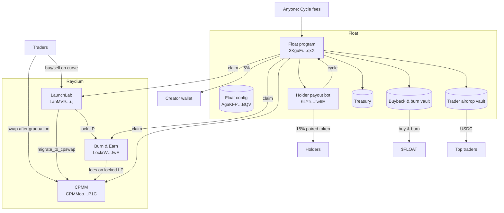

# Architecture

Float is a thin layer of fee routing on top of three Raydium programs.

## Lifecycle of a fee

1. **Trade.** A trade on the LaunchLab curve pays
   `fee = ceil(amount × total_rate / 1e6)`, which LaunchLab splits into protocol,
   platform and creator portions. The platform portion is recorded in the
   pool's `platform_fee` and stays in its quote vault.
2. **Graduation.** `migrate_to_cpswap` moves liquidity to CPMM. Afterwards, fees
   reach Float through the CPMM pool's creator-fee accounting
   (`creator_fees_token_0/1`) and the fees earned by locked LP in Burn & Earn.
3. **Cycle.** The payout bot (every few minutes) or anyone pressing **Cycle
   fees** calls the Float program. It claims the coin's pending fees from
   Raydium and runs the guarded swaps.
4. **Split.** 15 / 5 / 35 / 35 / 10 to holders, creator, flagship, traders and
   treasury.
5. **Distribution.**
   - Holders: the payout bot transfers the paired token pro rata.
   - Flagship: SOL accumulates; ~5 SOL or 4 h triggers a ≤ 1%-impact $FLOAT buy,
     then a burn.
   - Traders: USDC accumulates for the next scheduled airdrop.

## What's on chain and what's off chain

| Component | Where | Verifiable via |
| --- | --- | --- |
| Curve, pools, fee accounting | Raydium programs | Account state (`float pool`, `float inspect`) |
| Fee claim + split + swaps | Float program | Transaction history of the vaults |
| Holder payouts | Payout bot (off-chain logic, on-chain transfers) | `float payouts` |
| Buybacks & burns | Vault + bot | `float burns` |
| Airdrop ranking | Off chain (leaderboard) | `float airdrop` on your own trade export |

## How this repository maps to it

| Module | Covers |
| --- | --- |
| `sdk/src/raydium/launchlab.ts` | LaunchLab PDAs, account decoding, curve quotes, trade + fee-claim instructions |
| `sdk/src/raydium/cpmm.ts` | CPMM PDAs, decoding, swap math (port of the Rust calculator), swap + creator-fee instructions |
| `sdk/src/raydium/lock.ts` | Burn & Earn PDAs and `collect_cp_fees` |
| `sdk/src/float/feeSplit.ts` | The five-way split |
| `sdk/src/float/cycle.ts` | Pending-fee preview per coin |
| `sdk/src/float/holders.ts` | Holder snapshots and the payout reference model |
| `sdk/src/float/airdrop.ts` | Schedule, bot rules, wash filter, ranking, allocation |
| `sdk/src/float/buyback.ts` | Trigger rule and ≤ 1% impact sizing |
| `sdk/src/float/priceGuard.ts` | Cycle swap guard |
| `sdk/src/float/history.ts` | Burns and payouts from transaction history |
| `sdk/src/float/tickers.ts`, `pairs.ts` | Ticker rules, pair catalogue |
| `sdk/src/float/merkle.ts` | Airdrop merkle trees (byte-compatible with `float-core`) |
| `sdk/src/router/` | `float-router` client, PDAs, decoders |
| `crates/float-core` | `no_std` rules and math shared by the program |
| `programs/float-router` | On-chain reference implementation of the fee router ([spec](../programs/float-router.md)) |
