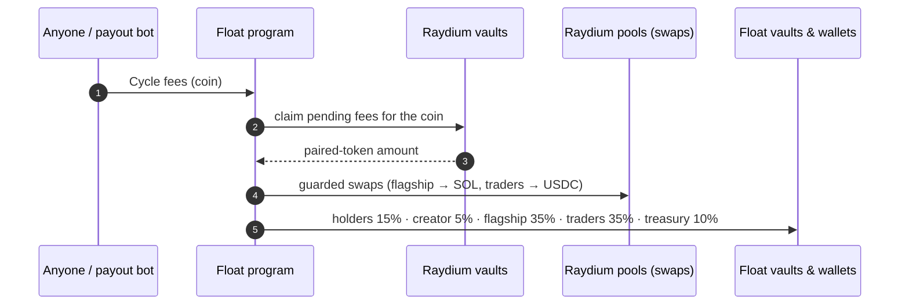

# Fee cycling

Trading fees don't move on every trade. They **accumulate in Raydium's vaults**
until someone **cycles** them. Cycling claims a coin's pending fees and
sends them through the [fee split](fee-split.md).

## Who can cycle

**Anyone.** Every coin page has a **Cycle fees** button. You don't need to hold
the coin or be its creator, and the proceeds always go to the split, never to
the person who pressed the button.

You rarely need to press it: the **payout bot cycles automatically** as part
of its regular runs.

## What a cycle does



Where the pending fees sit depends on the coin's stage:

| Stage | Where fees accumulate |
| --- | --- |
| Bonding curve | The coin's LaunchLab pool quote vault, tracked in `PoolState.platform_fee` |
| Graduated (CPMM) | The CPMM pool vaults, tracked in `PoolState.creator_fees_token_0/1`, plus fees earned by the locked LP position in Burn & Earn |

## Preview a cycle

The CLI reads those vaults directly and shows what a cycle would move right now:

```text
$ npm run float -- cycle <coin-mint>
Coin 9x…Lp — bonding (41.20% of curve)

Pending fees attributable to this coin:
source                       account       amount  note
---------------------------  ------------  ------  ---------------------------------------------
launchlab-pool-platform-fee  4Fk…quoteVlt  2.031   Platform fee earned on the bonding curve, ...

A cycle now would route 2.031:
bucket    amount   to
--------  -------  -----------------------------------------------------
Holders   0.30465  Holder payout bot → each holder's token account, ...
...
```

## Price guard

Cycling swaps part of the fees: the flagship share to SOL, the traders' share
to USDC, and on graduated pools any fees collected in the coin itself back to
the paired token. Each swap carries a **price guard**, a minimum output based
on a reference price. If the pool has moved too far, the swap fails instead of
filling at a bad price.

A trader who moves the price right before a cycle can still capture **up to
about 2% of a swap** before the guard trips. The SDK models this as a 200 bps
tolerance:

```ts
import { minOutWithGuard, maxExtractable } from "@float-community/sdk";
minOutWithGuard(1_000_000n); // 980_000n
maxExtractable(1_000_000n);  //  20_000n
```

> [!NOTE]
> Some tokens on older Raydium pools are swapped only by the payout bot, not by
> the on-page Cycle button.

## Vaults involved

| Vault | Holds |
| --- | --- |
| Buyback & burn vault `8Csko…DYAa` | Flagship share waiting to be used for $FLOAT buybacks |
| Trader airdrop vault `JEK3W…3snH` | Traders' share (USDC) waiting for the next airdrop |
| Treasury `2LMWF…mDFQ` | Treasury share, ticker reuse fees |
| Holder payout bot `6LYfr…fw6E` | Holders' share being distributed |

Full list in [Contracts](../contracts.md).
