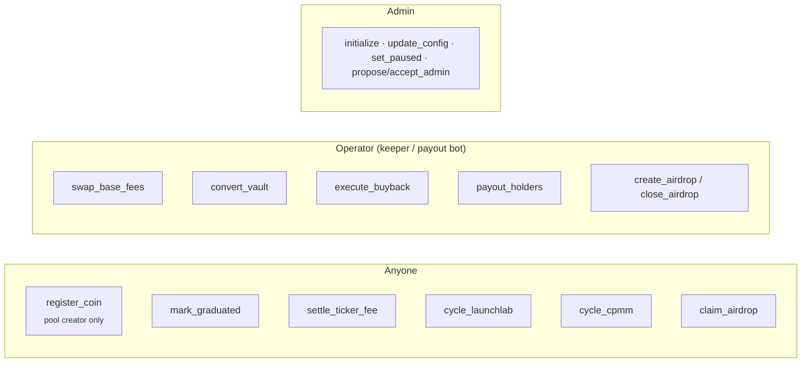

# float-router: program specification

> `float-router` is a **community reference implementation**. It is not the
> program the Float team deployed at `3KguFi7Y…JTqxX`, whose source is not
> public. It implements the mechanics in Float's documentation on top of the
> real Raydium programs, with each rule enforced on chain. Anyone running a
> LaunchLab platform can deploy it to route their platform's fees the same way.

| Property | Value |
| --- | --- |
| Source | [`programs/float-router`](../../programs/float-router) |
| Framework | Anchor 0.31.1 · Solana 2.1 |
| Default program id | `AYBmMVxnWC2o5JGPZm8xo4nrh7fAmxLfrxC3e2RaKomt` (run `anchor keys sync` for your own) |
| Pure logic | [`crates/float-core`](../../crates/float-core) (`no_std`, zero dependencies, host-tested) |
| Client | `router.RouterClient` in `@float-community/sdk`; IDL generated from the Rust source |
| Status | Unaudited reference code. Do not use with real funds without an audit. |

## Trust model



- **Permissionless** instructions can only move funds along fixed routes:
  the split destinations, the launcher or treasury, or a merkle-committed
  wallet. The caller never receives anything.
- **Operator** instructions involve a price (conversions, buybacks) or
  off-chain data (holder balances, airdrop rankings). The program bounds
  them:
  - every swap enforces a reference-price guard (`guard_bps`, default 2%);
  - buybacks enforce the trigger rule and the ≤ 1% impact cap, computed on
    chain from live reserves;
  - payouts can never exceed the coin's accrued `holders_unpaid`;
  - airdrops can never pay more than the round total, or pay anyone outside
    the root.
- **Admin** can change parameters within validated bounds and pause the
  program. Admin transfer takes two steps.

## Accounts

| Account | Seeds | Purpose |
| --- | --- | --- |
| `RouterConfig` | `["config"]` | Admin, operator, treasury, flagship mint, LaunchLab platform config, split, guard, impact cap, buyback parameters and lifetime stats |
| authority (PDA, no data) | `["authority"]` | Signs every vault transfer and Raydium CPI. Must be the platform's `platform_fee_wallet` **and** `platform_cp_creator` |
| `CoinRecord` | `["coin", mint]` | Coin metadata, launch/graduation times, reuse-fee state, lifetime split totals, `holders_unpaid`, `pending_base_fees` |
| `TickerRecord` | `["ticker", TICKER]` | Launch counter per normalised ticker |
| ticker escrow (system PDA) | `["ticker_escrow", mint]` | Holds a coin's 1 SOL reuse fee until settled |
| vault | `["vault", kind, mint]` | `kind` 0 holders · 1 flagship · 2 traders; token accounts owned by the authority |
| intake | ATA(authority, mint) | Where Raydium fee claims land before routing |
| `AirdropRound` | `["airdrop", round_id_le]` | Merkle root, total, claimed, expiry |
| airdrop escrow | `["airdrop", round_id_le, "escrow"]` | USDC for the round |
| `ClaimReceipt` | `["claim", round_id_le, index_le]` | Exists once a leaf has been claimed (prevents double claims) |

## Instructions

### Coins & tickers

| Instruction | Who | Effect |
| --- | --- | --- |
| `register_coin(ticker, creator_wallet)` | LaunchLab pool creator | Verifies the pool PDA, the platform config, the creator and that it hasn't graduated. Increments the ticker counter and escrows **1 SOL** if the ticker was launched before (from 2026-11-05 04:01 UTC) |
| `mark_graduated` | anyone | Records `graduated_at` once the LaunchLab pool reports `status = 2` |
| `settle_ticker_fee` | anyone | Refunds the launcher if graduation came within **48 h** of launch; otherwise, once the window has passed, releases the fee to the treasury |

### Fee cycling

| Instruction | Who | Effect |
| --- | --- | --- |
| `cycle_launchlab` | anyone | CPI `LaunchLab::claim_platform_fee`, measures the intake delta, then splits it **15 / 5 / 35 / 35 / 10** |
| `cycle_cpmm` | anyone | CPI `CPMM::collect_creator_fee`. Splits the paired-token delta; credits the coin-side delta to `pending_base_fees` |
| `swap_base_fees(amount, ref_price)` | operator | Swaps pending coin-side fees to the paired token with the price guard, then splits the proceeds |

Split routing (`route.rs`): holders → `vault[0][paired]` (and
`coin.holders_unpaid += holders`), flagship → `vault[1][paired]`, traders →
`vault[2][paired]`, creator → a token account owned by `creator_wallet`,
treasury → a token account owned by `treasury`.

### Conversions, buyback, payouts, airdrops

| Instruction | Who | Guards |
| --- | --- | --- |
| `convert_vault(kind, amount, ref_price)` | operator | Flagship can only go to WSOL, traders only to USDC; output ≥ `ref · (1 − guard)` |
| `execute_buyback(amount, ref_price)` | operator | `≥ 5 SOL` or `≥ 4 h` since the last buy; on-chain simulated impact ≤ `max_impact_bps`; output ≥ guard. Everything bought is **burned in the same instruction** |
| `payout_holders(round, amounts)` | operator | Up to 20 recipients per call; each must be a token account of the paired mint; `Σ amounts ≤ holders_unpaid` |
| `create_airdrop(round_id, root, total, expires_at)` | operator | Moves `total` USDC from `vault[2][USDC]` into the round escrow |
| `claim_airdrop(round_id, index, amount, proof)` | anyone | Verifies `sha256` merkle proof (domain-separated leaves/nodes); one receipt per index; `claimed ≤ total` |
| `close_airdrop(round_id)` | operator | After expiry, returns unclaimed USDC to the traders vault |

## Invariants

1. **Conservation.** For every cycle, `holders + creator + flagship + traders + treasury == claimed`.
   This is `float_core::split::split`, which a test checks for every amount in `0..5000` and at `u64::MAX`.
2. **Attribution.** Routed amounts are measured as balance deltas around a single
   coin's CPI, so fees are never attributed to the wrong coin.
3. **Holder solvency.** `Σ payouts(coin) ≤ Σ holders_share(coin)`, enforced by `holders_unpaid`.
4. **Burn completeness.** `execute_buyback` burns exactly the $FLOAT it received in the same instruction.
5. **Airdrop integrity.** `Σ claims(round) ≤ total(round)`; each index pays at most once,
   and only to the wallet committed in the root.
6. **Bounded slippage.** No operator swap can return less than `ref · (1 − guard_bps)`.

## Events

`ConfigUpdated`, `CoinRegistered`, `CoinGraduated`, `TickerFeeSettled`,
`FeesCycled`, `VaultConverted`, `BuybackBurned`, `HoldersPaid`,
`AirdropCreated`, `AirdropClaimed`, `AirdropClosed`. Each carries enough data
to rebuild every balance from logs alone.

## Deployment

```bash
scripts/router/deploy.sh devnet
node scripts/router/init.ts --operator <bot> --treasury <wallet> \
  --flagship-mint <mint> --platform-config <launchlab-platform-config> --pairs <mint,…> --send
```

Then the LaunchLab platform admin sets, on the platform config:

| Field | Value |
| --- | --- |
| `platform_fee_wallet` | router authority PDA (printed by `init.ts`) |
| `platform_cp_creator` | router authority PDA |

Run the bots:

```bash
node scripts/keeper/keeper.ts --flagship-pool <float-sol-cpmm-pool> --send
node scripts/keeper/payout-bot.ts --prices prices.json --send
```

See [Scripts](../developers/scripts.md).

## Known limitations

- LaunchLab's `claim_platform_fee` only supports the classic SPL Token program
  for the quote side. Token-2022 paired tokens can be cycled only after
  graduation, through `cycle_cpmm`.
- The authority PDA holds no lamports, so the intake ATAs (and creator/treasury
  token accounts) must exist before cycling. The keeper creates them
  idempotently in the same transaction.
- Reference prices come from the operator. Use a TWAP (the CPMM observation
  account) or an external oracle in production rather than the instantaneous spot.
- Graduation time is recorded when `mark_graduated` is called, not when the
  migration happened. Keepers should call it promptly; the 48 h refund depends on it.
