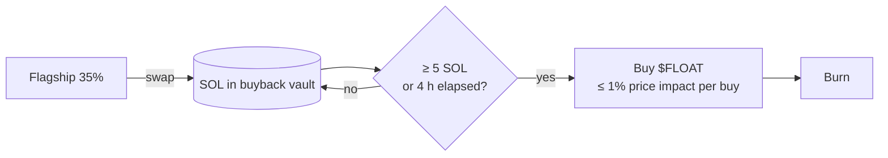

# Flagship: $FLOAT buyback & burn

**35%** of every Float coin's platform fees buy back **$FLOAT** and **burn it
on chain**.

| | |
| --- | --- |
| $FLOAT mint | `Bv1a7cEj5aRnJQhMw4kRQqAFesMSd5LwcDnUzq52BMmr` |
| Buyback & burn vault | `8CskoMx4FaXjp7gzxNzaWQXGXGVBWYnNWXGcisXuDYAa` |
| Public record | [Burns page](https://www.floatlaunch.xyz/burns) |

## How it works

1. During a fee cycle, the flagship share is **swapped to SOL** and sent to the
   buyback & burn vault.
2. A buy fires when about **5 SOL** has accumulated, or with **whatever has
   accumulated after 4 hours**, whichever comes first.
3. **No single buy can move the $FLOAT price by more than 1%.** Larger amounts
   are split into several buys.
4. The $FLOAT bought is **burned**: it's removed from supply permanently, with
   an on-chain SPL `burn`.



## Sizing under the 1% cap

For a constant-product pool with `x` SOL in reserve, a buy of `dx` moves the
spot price by about `(1 + dx/x)² − 1`. Staying under 1% means each buy is at
most roughly **0.5% of the pool's SOL reserve**. The SDK finds the exact
maximum by binary search over the real CPMM swap math, fees included:

```bash
$ npm run float -- buyback 30 --sol-reserve 2000 --float-reserve 50000000
buy  sol
---  ------------
1    10.100882725
2    10.151769106
3    9.747348169

3 buys, each ≤ 1% price impact. Leftover: 0 SOL
```

Or against the live $FLOAT pool:

```bash
npm run float -- buyback 30 --pool <float-cpmm-pool>
```

## Verify the burns

```bash
npm run float -- burns --limit 200
```

The command walks the buyback vault's transactions and sums every `burn` /
`burnChecked` of the $FLOAT mint.

## What isn't part of the buyback

- **$FLOAT's own trading fees** go to the Float dev wallet, not to this split.
- **XBTC- and XHYPE-paired coins.** Their flagship share can't be swapped to SOL
  until a Raydium pool into SOL or USDC exists. It waits in the vault until then.
