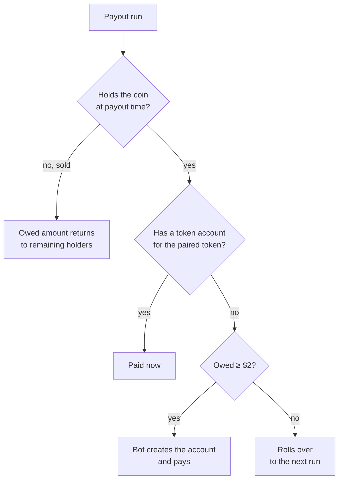

# Holder rewards

Holders receive **15%** of their coin's platform fees, **in the coin's paired
token**, **pro rata to how much of the coin they hold**.

## How payouts work

- A **payout bot** runs **every few minutes**. It cycles fees and pays
  holders.
- You are paid **wherever you bought**: on Float, on Raydium, through Jupiter,
  or by transfer from another wallet. Only your balance at payout time matters.
- Payouts go to your wallet's **token account for the paired token**.
- If you don't have that token account yet, the bot **creates one for you once
  you're owed at least $2**. Smaller amounts **roll over** to later runs until
  they reach $2.
- **Selling before a payout returns what was still owed to the coin's
  holders.** Unpaid rewards aren't kept by sellers; they go back to the people
  still holding.



## Which balances count

Liquidity is not a holder. Coins sitting in the LaunchLab curve vault, the
CPMM pool vaults or locked in Burn & Earn are excluded. The SDK's default
exclusion list covers the authorities that own those vaults:

| Excluded owner | Why |
| --- | --- |
| LaunchLab authority `WLHv2UAZ…VVh` | Owns the bonding-curve vaults |
| CPMM authority `GpMZbSM2…bL` | Owns graduated pool vaults |
| Burn & Earn authority `3f7GcQFG…xH` | Holds locked LP |
| Incinerator `1nc1nerator11…` | Burn address |

Snapshot a coin's holders and their reward shares:

```bash
npm run float -- holders <coin-mint> --top 20
```

## Checking your payouts

Every payout is an on-chain transfer from the holder payout bot
(`6LYfrwR67XS8zJPxD2PTEHKocr3d2MBgkZX8umGTfw6E`):

```bash
npm run float -- payouts --wallet <your-wallet>
npm run float -- payouts --wallet <your-wallet> --summary   # totals per paired token
```

## Managing many paired tokens

If you hold coins with different pairs, you'll receive several different
tokens. The [Profile page](../getting-started/site-pages.md#profile-tools) can
swap listed tokens to SOL (up to 4 per wallet approval, via Jupiter), unwrap
wrapped SOL, and keep token accounts open so payouts land right away.

## Reference model

The SDK includes a deterministic model of one payout round
(`computePayoutRound`) that follows these rules. It lets you reproduce what a
payout should look like for a given snapshot:

```ts
import { computePayoutRound } from "@float-community/sdk";

const round = computePayoutRound({
  amount: 10_000_000n,       // 10 USDC to distribute
  usdPerUnit: 1e-6,          // USDC raw unit = $0.000001
  holders: [
    { owner: "A", balance: 700n, previousBalance: 700n, carried: 0n, hasTokenAccount: true  },
    { owner: "B", balance: 250n, previousBalance: 250n, carried: 0n, hasTokenAccount: false },
    { owner: "C", balance:  50n, previousBalance:  50n, carried: 0n, hasTokenAccount: false },
  ],
});
// A paid 7 USDC; B owed $2.50 → account created, paid; C owed $0.50 → rolls over
```

In the model, a partial sell forfeits the carried amount **in proportion to
the coins sold** since the previous run. A full exit forfeits all of it.
Forfeits are redistributed to current holders in the same round.

## When rewards pause

- **Issuer pauses.** If a tokenized-stock issuer pauses its token, trading and
  rewards for coins paired with it stop until the pause ends.
- **Transfer fees.** For pre-IPO pairs, the issuer's transfer fee (1% PreStocks,
  0.2% Tessera) is deducted from each payout in transit.
