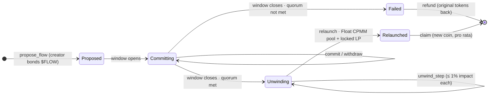
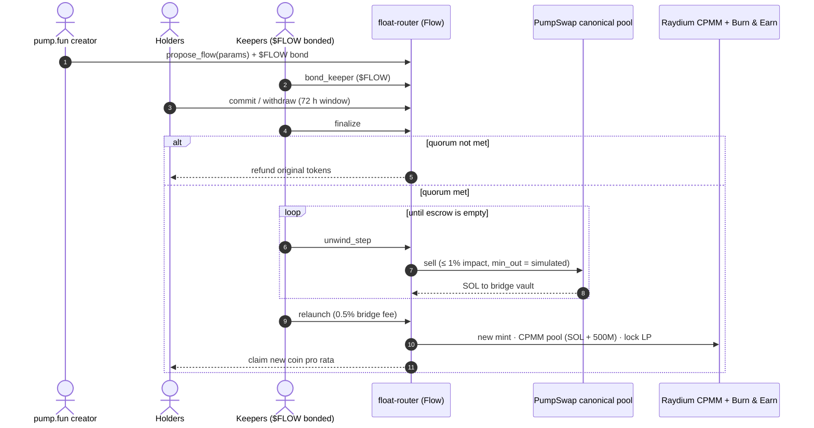

<div align="center">

<a href="#flow-token"></a>

# Flow by Float · $FLOW

<p><b>Move a pump.fun coin's community and liquidity to Float</b><br/>Protocol bridge specification · v0.2</p>

`Stage: 🧪 test phase (devnet only)` · `Mainnet: not deployed` · `Program: float-router extension` · `Token: $FLOW`

</div>

## $FLOW token

| Field | Value |
| :-- | :-- |
| Name | Flow |
| Ticker | `$FLOW` |
| Mint | `<FLOW_MINT_ADDRESS>` *(not yet deployed; this is the only place the mint will be published)* |
| Mint authority | Revoked at launch |
| Freeze authority | Revoked at launch |

> [!CAUTION]
> Until the fields above are filled in **in this repository**, any "$FLOW" token you see trading is not this one.

<br/>

## TL;DR

A pump.fun coin can't be "moved": its mint is fixed and the liquidity created at graduation is locked forever, because pump.fun **burns the LP tokens** of the PumpSwap pool. Flow does the only thing that is actually possible on chain:

1. **Holders commit** their pump.fun tokens to an on-chain escrow during a time-boxed window. They can withdraw at any moment until it closes.
2. If a **quorum** is reached, the committed tokens are **sold back into the canonical PumpSwap pool** in small, impact-capped steps. That pulls real SOL out of the locked liquidity.
3. That SOL, minus a **0.5% bridge fee**, seeds a **new Float coin** on a Raydium CPMM pool. The pool's LP is **locked**, and its fees flow into **Float's 15 / 5 / 35 / 35 / 10 split**.
4. Committers **claim the new coin pro rata**. If the quorum isn't reached, everyone gets their original tokens back, with no fee.

**$FLOW** coordinates the parties a migration needs besides holders: it is bonded by **keepers** who run the ~300 unwind transactions, and by **creators** who open proposals. Holders only ever touch their own coin.

The outcome for a committer is **economically equal to selling at the average unwind price, less 0.5%**, while keeping exposure to the coin, now on Float with Float's rewards.

<br/>

## Contents

1. [Why a bridge, and why a token](#1-why-a-bridge-and-why-a-token)
2. [Lifecycle](#2-lifecycle)
3. [Economics](#3-economics)
4. [Worked example](#4-worked-example)
5. [On-chain design](#5-on-chain-design)
6. [Parameters](#6-parameters)
7. [Security model](#7-security-model)
8. [Who should and shouldn't use Flow](#8-who-should-and-shouldnt-use-flow)
9. [Test phase](#9-test-phase)
10. [FAQ](#10-faq)
- [References](#references)

<br/>

## 1. Why a bridge, and why a token

### 1.1 Why a bridge is needed

How pump.fun coins are structured today:

| Fact | Consequence for a migration |
| :-- | :-- |
| Every coin starts on a constant-product bonding curve: **1B supply, ~793M sold on the curve**, virtual reserves of 30 SOL and ~1.07B tokens | Once graduated, ~793M tokens are in holders' hands |
| At graduation, the remaining **~206.9M tokens** and the curve's SOL seed a **PumpSwap** pool | The pool holds far fewer tokens than circulate |
| Graduations go to **PumpSwap** (live since 20 March 2025) | Program `pAMMBay6oceH9fJKBRHGP5D4bD4sWpmSwMn52FMfXEA` |
| **The LP tokens are burned** at graduation | Nobody, not even the creator, can withdraw that liquidity. SOL leaves the pool **only through trades** |
| Canonical PumpSwap pools (created by the Pump `migrate` instruction) pay **coin creator fees** | The pump.fun creator keeps earning on the old pool. Flow doesn't touch that |
| New coins may be **Token-2022** (`create_v2`) | The escrow must support both SPL Token and Token-2022 |

**So there's no "migrate liquidity" button anywhere.** The only on-chain path from a burned-LP pool to a new pool is: *holders sell into the old pool, and the proceeds seed the new one.* Flow makes that path **collective, transparent, reversible until the last moment, and impact-controlled**, instead of a stampede of individual sells.

### 1.2 Why a coordination token ($FLOW)

Making the path collective solves the holders' problem, but it creates three new ones that SOL and the coins being migrated can't solve on their own.

**Somebody has to run the unwind, and be accountable for it.** A quorum-sized migration takes **~185–315 capped sells**, each spaced at least `min_step_interval` slots apart, followed by a relaunch that creates a mint, metadata, a CPMM pool and a Burn & Earn lock. The instructions are permissionless, but "anyone can call it" doesn't mean anyone will, on time, under congestion. If the unwind stalls halfway, the old pool has already lost much of its price and the new coin doesn't exist yet: the worst state for everyone. A plain SOL tip pays keepers but can't be **taken back** when they fail. Keepers who want the step reward instead **bond $FLOW** on a proposal, and the program can **slash that bond** on a condition it can check by itself: no step for `keeper_grace_slots` while the bonded keeper was on duty.

**Proposals need a cost that isn't paid by holders.** Restricting proposals to the bonding-curve `creator` stops strangers, but not a creator who opens a migration on every coin they ever launched to farm attention, locking holders' tokens in 72-hour windows that go nowhere. A **$FLOW proposal bond** fixes this without charging holders: it's returned in full if the proposal relaunches or reaches at least `bond_refund_floor` of its quorum, and partly burned otherwise.

**The bridge needs a shared asset across migrations.** Every migration produces a different new coin, and the old coins are what's being exited, so neither can carry incentives from one migration to the next. Paying keepers in the new coin would also make them sellers of it from the first block. $FLOW is the one asset that spans every migration: the **0.5% bridge fee** (in SOL) pays keepers' transaction and rent costs, and the rest **buys back $FLOW** under the same ≤ 1% impact rule and splits it between **burn** and **bonded keepers**. Keepers' rewards therefore grow with total migrated volume, not with any single coin.

**What $FLOW deliberately does *not* do.**

| $FLOW is used for | $FLOW is **never** used for |
| :-- | :-- |
| Keeper bonds and keeper rewards | Committing, withdrawing, refunding or claiming: holders never need it |
| Creator proposal bonds | Voting on, or overriding, any escrow movement |
| Receiving the buyback share of the bridge fee | Pricing the new coin: the pool is seeded with **SOL only** |
| | Changing the parameter bounds, which are fixed in the program |

A failed migration costs holders **nothing**: the bridge fee is taken only from SOL extracted in a successful unwind.

<br/>

## 2. Lifecycle



### Phase 1: Proposal

Only the coin's **pump.fun creator** (the `creator` recorded on its bonding curve) can propose, and must lock `proposal_bond` $FLOW. This prevents strangers from opening migrations of coins they don't represent, and makes spam proposals costly.

The proposal fixes, immutably:

| Field | Meaning |
| :-- | :-- |
| `old_mint` | The pump.fun coin |
| `canonical_pool` | Its PumpSwap pool, verified as the one created by Pump's `migrate` |
| `ticker`, `name`, `uri` | Identity of the Float coin |
| `paired_mint` | SOL in v0.2 |
| `creator_wallet` | Receives the Float creator share (5%) |
| `window` | Commit window length (default 72 h) |
| `quorum_bps` | Minimum share of circulating supply that must commit (default 40%) |
| `min_wallets` | Minimum number of distinct committers (default 100) |

### Phase 2: Commit window

- Holders **commit** any amount of the pump.fun coin into a **program-owned escrow** and receive a `CommitReceipt`.
- **Withdraw anytime** before the window closes: the full amount, no fee.
- Keepers **bond $FLOW** on the proposal to join its keeper set (`keeper_bond` each, up to `max_keepers`).
- The UI shows live **quorum progress**, the **projected SOL** extracted, the **projected opening price** on Float, the **projected impact on the old pool** and the **bonded keeper set**. All of it is computed with the exact constant-product formula on current reserves.

### Phase 3: Quorum check

When the window closes, anyone can call `finalize`:

| Condition | Result |
| :-- | :-- |
| committed ≥ `quorum_bps` × circulating **and** committers ≥ `min_wallets` **and** at least one bonded keeper | **Unwinding** |
| otherwise | **Failed**: every committer calls `refund` (or a keeper pushes refunds) and gets the original tokens back |

*Circulating* = total supply − tokens held by the canonical pool, measured when the window opens.

On **Failed**, the creator's bond is returned if commitments reached `bond_refund_floor` of the quorum; otherwise `bond_burn_bps` of it is burned. Keeper bonds are always returned.

### Phase 4: Unwind

The committed tokens are sold into the canonical PumpSwap pool by **`unwind_step`**, a permissionless instruction (run by keepers) that:

1. reads the pool's live reserves;
2. computes the largest sell whose **price impact is ≤ 1%**, the same rule Float uses for $FLOAT buybacks;
3. executes it via CPI with a minimum output equal to the simulated output;
4. accumulates the SOL in the bridge vault;
5. credits the step reward to the caller **if** it is a bonded keeper.

Steps are **rate-limited** (one per `min_step_interval` slots), and their size caps any front-running profit at the 1% impact limit. Each step stands alone; there's no large pending order to sandwich.

If no step lands for `keeper_grace_slots`, anyone can call `slash_idle_keeper`: `keeper_slash_bps` of the on-duty keeper's bond is burned, and duty rotates to the next bonded keeper. Unbonded callers can always push steps too, so **liveness never depends on $FLOW**: the bond only decides who gets paid.

### Phase 5: Relaunch on Float

When all committed tokens are sold, `relaunch`:

1. takes the **0.5% bridge fee** from the SOL vault (keeper costs first, then a $FLOW buyback that is split between burn and bonded keepers);
2. creates the **new mint** (classic SPL Token, 6 decimals, **1,000,000,000 supply**), writes Metaplex metadata and **revokes mint and freeze authority**;
3. creates a **Raydium CPMM pool** with **all remaining SOL** and **500,000,000 new tokens**. The router authority is the pool creator, so creator fees flow to the Float split;
4. locks the LP in **Raydium Burn & Earn**. The fee NFT is held by the router authority, so liquidity can never be pulled and LP fees also feed the split;
5. registers the coin in the router as **already graduated**, so the ticker refund rule settles immediately;
6. releases the creator's proposal bond.

The coin then behaves like any graduated Float coin: **cycling, holder payouts, buybacks and airdrops** apply from the first trade.

### Phase 6: Claim

Committers claim **500,000,000 × their commit ÷ total committed** new tokens. Keepers push claims automatically; manual `claim` is always available. Nothing expires.

<br/>

## 3. Economics

Notation: canonical pool reserves `x` SOL and `y` tokens, total committed `S`, PumpSwap fee `f`, bridge fee `φ` (0.5%).

**SOL extracted.** Selling `S` into a constant-product pool returns, ignoring the rounding of 1% steps:

```text
E = x · S(1 − f) / (y + S(1 − f))
```

`E` is a **floor**: if outside buyers trade the old pool during the unwind, more SOL comes out.

**SOL seeding the Float pool.**

```text
E_net = E · (1 − φ)
```

**Opening price on Float.**

```text
P_open    = E_net / 500,000,000                (SOL per new token)
MCAP_open = 1,000,000,000 · P_open = 2 · E_net
```

**What a committer gets.** A commit of `d` old tokens receives `500M · d / S` new tokens, worth at the opening price

```text
500M · d / S  ×  E_net / 500M  =  d · E_net / S  =  d × (average unwind price) × (1 − φ)
```

That's what `d` would have fetched if all committers had sold together, less the 0.5% that pays the people running the unwind. The committer keeps exposure, now on Float, with holder rewards on all future volume.

**Impact on holders who don't commit.** The old pool's price falls by

```text
1 − ( y / (y + S(1 − f)) )²
```

That's large, and it's why the quorum is high and the projection is shown before anyone commits.

**Why the opening market cap is lower than pump.fun's.** At graduation a pump.fun pool prices 1B tokens off ~206.9M pooled tokens. Most of the headline market cap is not backed by extractable SOL, because part of the SOL side can never be pulled out of a constant-product pool. Flow's opening market cap reflects only the SOL that actually comes out. **That's a property of AMMs, not a cost of the bridge.**

<br/>

## 4. Worked example

A pump.fun coin whose canonical pool is still at its **graduation state**: about **85 SOL** and **206.9M tokens**, with 793.1M tokens circulating. Fees `f = 0.25%`, `φ = 0.5%`, SOL at **$87**. Every figure is computed from the formulas above.

| Committed (of circulating) | Tokens committed | SOL extracted | Bridge fee | Pool seed (SOL) | ≈ USD | Unwind steps (≤ 1% each) | Old pool price change | New tokens per old token | Float opening MCAP |
| --: | --: | --: | --: | --: | --: | --: | --: | --: | --: |
| 25% | 198.3M | 41.54 | 0.21 | 41.33 | $3,596 | ~133 | −73.9% | 2.5218 | 82.7 SOL · $7,192 |
| **40% (quorum)** | **317.2M** | **51.40** | **0.26** | **51.14** | **$4,449** | **~185** | **−84.4%** | **1.5761** | **102.3 SOL · $8,898** |
| 60% | 475.9M | 59.20 | 0.30 | 58.90 | $5,124 | ~237 | −90.8% | 1.0507 | 117.8 SOL · $10,249 |
| 80% | 634.5M | 64.06 | 0.32 | 63.74 | $5,545 | ~279 | −93.9% | 0.7880 | 127.5 SOL · $11,090 |
| 100% | 793.1M | 67.38 | 0.34 | 67.04 | $5,833 | ~313 | −95.7% | 0.6304 | 134.1 SOL · $11,665 |

The 25% row is below the default quorum; it's shown for comparison only. For reference, the same pool at graduation implies a pump.fun market cap of **≈ 410.8 SOL (≈ $35,742)**. The gap is the unextractable part of the AMM curve, as explained above.

**Reading the table at 60%.** Committers deliver 475.9M tokens, and ~237 capped sells pull **59.20 SOL** out of the old pool. 0.30 SOL goes to the bridge fee, so the Float pool opens with **58.90 SOL** and 500M tokens, at a market cap of **117.8 SOL**. A wallet that committed 10M old tokens claims **10.507M** new tokens, worth **≈ 1.238 SOL**: its share of a collective sell, less 0.5%. From then on it earns **15% of the coin's Float fees, pro rata**.

<br/>

## 5. On-chain design

Flow is an extension of [`float-router`](../programs/float-router.md). Pure math lives in `float-core` (`flow` module); the program only orchestrates.

### Accounts

| Account | Seeds | Purpose |
| :-- | :-- | :-- |
| `FlowProposal` | `["flow", old_mint]` | Parameters, state, totals, timestamps, keeper duty, new mint once relaunched |
| commit escrow | `["flow_escrow", proposal]` | Token account (Token or Token-2022) owned by the router authority |
| `CommitReceipt` | `["flow_commit", proposal, wallet]` | Committed amount; closed on refund or claim |
| SOL vault | `["flow_sol", proposal]` | WSOL account accumulating unwind proceeds |
| new mint | `["flow_mint", proposal]` | Created at relaunch; authorities revoked |
| creator bond | `["flow_creator_bond", proposal]` | $FLOW locked by the creator |
| `KeeperBond` | `["flow_keeper", proposal, keeper]` | $FLOW bonded by a keeper, steps run, rewards owed |
| fee vault | `["flow_fees"]` | Global; bridge fee before buyback and distribution |

### Instructions

| Instruction | Caller | Checks |
| :-- | :-- | :-- |
| `propose_flow` | pump.fun creator | Signer = bonding-curve `creator`; curve `complete`; pool is the canonical PumpSwap pool for the mint; no live proposal; `proposal_bond` $FLOW transferred |
| `commit(amount)` | holder | State `Committing`; before `closes_at`; `transfer_checked` into escrow |
| `withdraw(amount)` | holder | State `Committing`; amount ≤ receipt |
| `bond_keeper` | keeper | State `Proposed` or `Committing`; `keeper_bond` $FLOW; keeper set not full |
| `finalize` | anyone | After `closes_at`; sets `Unwinding` or `Failed` by quorum, `min_wallets` and keeper set; settles creator bond on failure |
| `refund` | anyone (to the receipt owner) | State `Failed`; returns the exact committed amount |
| `unwind_step` | anyone | State `Unwinding`; slot ≥ `last_step + min_step_interval`; size = max under 1% impact on live reserves; CPI PumpSwap `sell` with `min_out` = simulated output; reward accrues only to bonded keepers |
| `slash_idle_keeper` | anyone | State `Unwinding`; slot ≥ `last_step + keeper_grace_slots`; burns `keeper_slash_bps` of the on-duty bond; rotates duty |
| `relaunch` | anyone | Escrow empty; takes bridge fee; creates mint and metadata; CPMM `initialize` with the SOL vault and 500M tokens; Burn & Earn lock; registers the coin; releases creator bond |
| `claim` | anyone (to the receipt owner) | State `Relaunched`; pays `500M × committed ÷ total`; closes the receipt |
| `unbond_keeper` | keeper | State `Relaunched` or `Failed`; returns remaining bond and accrued rewards |
| `distribute_fees` | anyone | Buys $FLOW from the fee vault at ≤ 1% impact; splits burn / keepers per `fee_burn_bps` |

### Events

`FlowProposed`, `Committed`, `Withdrawn`, `KeeperBonded`, `FlowFinalized{quorum_met}`, `UnwindStep{sold, sol_out, impact_bps, keeper}`, `KeeperSlashed{keeper, amount}`, `FlowRelaunched{new_mint, pool, sol, tokens, bridge_fee}`, `FlowClaimed`, `FlowRefunded`, `FeesDistributed{flow_bought, burned, to_keepers}`.

### End-to-end sequence



<br/>

## 6. Parameters

### Migration

| Parameter | Default | Bounds | Why |
| :-- | :-- | :-- | :-- |
| `window` | 72 h | 24 h – 7 d | Long enough for holders in every time zone to decide |
| `quorum_bps` | 4000 (40%) | 2500 – 9000 | Protects non-committers from a small group crashing the old pool |
| `min_wallets` | 100 | ≥ 25 | Prevents a single whale from forcing a migration |
| `max_step_impact_bps` | 100 (1%) | 25 – 100 | Matches Float's buyback rule; caps sandwich profit per step |
| `min_step_interval` | 10 slots | ≥ 2 | Spreads the unwind so arbitrage can refill the old pool |
| `liquidity_tokens` | 500,000,000 | fixed | Half of the new supply backs the pool, half goes to committers |
| `new_supply` | 1,000,000,000 | fixed | Same scale as pump.fun and LaunchLab coins |
| `paired_mint` | SOL | SOL only in v0.2 | USDC pairs need an extra conversion step |

### $FLOW

| Parameter | Default | Bounds | Why |
| :-- | :-- | :-- | :-- |
| `bridge_fee_bps` | 50 (0.5%) | 0 – 100 | Pays ~300 transactions and relaunch rent; funds the $FLOW buyback |
| `fee_burn_bps` | 5000 (50%) | 0 – 10000 | Share of bought-back $FLOW burned; the rest goes to bonded keepers |
| `proposal_bond` | `<TBD>` $FLOW | > 0 | Makes spam proposals costly without charging holders |
| `bond_refund_floor` | 5000 (50% of quorum) | 2500 – 10000 | A serious attempt that falls short gets its bond back |
| `bond_burn_bps` | 5000 (50%) | 0 – 10000 | Share of the creator bond burned on a non-serious failure |
| `keeper_bond` | `<TBD>` $FLOW | > 0 | Stake at risk for each keeper on a proposal |
| `max_keepers` | 8 | 1 – 32 | Enough for failover, few enough to keep rewards meaningful |
| `keeper_grace_slots` | 150 (~1 min) | ≥ 5 × `min_step_interval` | Tolerates congestion; punishes real outages |
| `keeper_slash_bps` | 1000 (10%) | 100 – 5000 | Per missed grace period; repeated outages compound |

All bounds are constants in the program. There is no admin key and no token vote that can change them.

<br/>

## 7. Security model

| Threat | Mitigation |
| :-- | :-- |
| **Phishing** ("send your tokens to migrate", "buy $FLOW to migrate") | Commits happen only through the program instruction. The escrow is a PDA, never a wallet. Holders never need $FLOW. The repo publishes the only program id and the only $FLOW mint |
| Fake $FLOW tokens | Only the mint listed in [$FLOW token](#flow-token) is valid; the program rejects any other mint for bonds |
| Proposal by someone unrelated to the coin | Only the bonding curve's recorded `creator` can propose |
| Spam proposals by the creator | `proposal_bond`, partly burned on non-serious failures |
| Fake or non-canonical pool | The pool must be the PumpSwap pool created by Pump's `migrate` for that mint |
| Admin seizing escrowed tokens | No instruction moves escrow except `withdraw`, `refund` and `unwind_step`. No admin override, and $FLOW grants no control over escrow |
| Sandwiching the unwind | Each step ≤ 1% impact with `min_out` = simulated output; steps are spaced and independent |
| Stalled unwind | Bonded keepers are slashed after `keeper_grace_slots`; anyone can still push steps |
| Whale-forced migration | `quorum_bps` + `min_wallets` |
| Rugging the new pool | LP locked in Burn & Earn; mint and freeze authority revoked at relaunch |
| Stuck funds | `refund` and `claim` are permissionless and never expire |

**Audit status:** unaudited, like the rest of `float-router`. Not for mainnet funds.

<br/>

## 8. Who should and shouldn't use Flow

| Good fit | Poor fit |
| :-- | :-- |
| A graduated coin whose community has moved on from pump.fun and wants Float's holder rewards | A coin where many holders are inactive: they can't commit, and the old price drop hits them |
| A creator coordinating a clear, public migration | Anyone hoping to keep the pump.fun headline market cap; the opening cap reflects extractable SOL only |
| Coins with an active pool, where outside buyers during the unwind raise `E` | Coins with little SOL left in the canonical pool |

<br/>

## 9. Test phase

Pump and PumpSwap programs are also deployed on **devnet**, so the full flow can be exercised end to end without real funds.

| Track | Scope | Status |
| :-- | :-- | :-- |
| Spec | This document, v0.2 | ✅ Draft |
| `float-core::flow` | Projection, step sizing, pro-rata claims, quorum and fee math; property tests vs. the formulas above | 🧪 In progress |
| Devnet: happy path | Create → graduate → propose → bond → commit → unwind → relaunch → claim | 🧪 Testing |
| Devnet: failure paths | Quorum missed, `min_wallets` missed, no keepers, withdraw-all, double claim, early finalize | 🧪 Testing |
| Devnet: keeper slashing | Idle keeper, duty rotation, unbonded caller pushes steps | ⏳ Planned |
| Devnet: Token-2022 mints | `create_v2` coins through escrow and unwind | ⏳ Planned |
| Load | ~300 unwind steps under congestion; keeper failover | ⏳ Planned |
| $FLOW mint | Deploy, publish mint here, revoke authorities | ⏳ Not started |
| Audit | Independent review of the router + Flow | ⏳ Not started |
| Mainnet | — | ⛔ Not deployed |

Feedback on parameters, especially `quorum_bps`, `min_wallets`, `bridge_fee_bps`, the bond sizes and the 50/50 supply split, is welcome via issues.

<br/>

<br/>

## References

- pump.fun bonding curve, graduation and LP burn: [Solana Compass](https://solanacompass.com/projects/pumpfun), [Cointelegraph](https://cointelegraph.com/news/how-pump-fun-captured-80-of-solana-memecoins-and-can-it-last)
- Curve arithmetic and unextractable liquidity: [On-chain Divers](https://onchaindivers.substack.com/p/the-176-sol-ghost-reverse-engineering)
- Program ids, creator fees on canonical pools, devnet deployment: [Pump developer updates](https://t.me/s/pump_tech_updates/17), [Solana Tracker](https://docs.solanatracker.io/guides/pumpfun-amm)
- Token-2022 via `create_v2`: [Bitquery Pump.fun API](https://docs.bitquery.io/docs/examples/Solana/Pump-Fun-API/)
- Official IDLs: [pump-fun/pump-public-docs](https://github.com/pump-fun/pump-public-docs)
- Float mechanics: [Float docs](https://www.floatlaunch.xyz/docs) · this repo's [fee split](../mechanics/fee-split.md) and [router spec](../programs/float-router.md)

<div align="center">
<br/>
</div>
